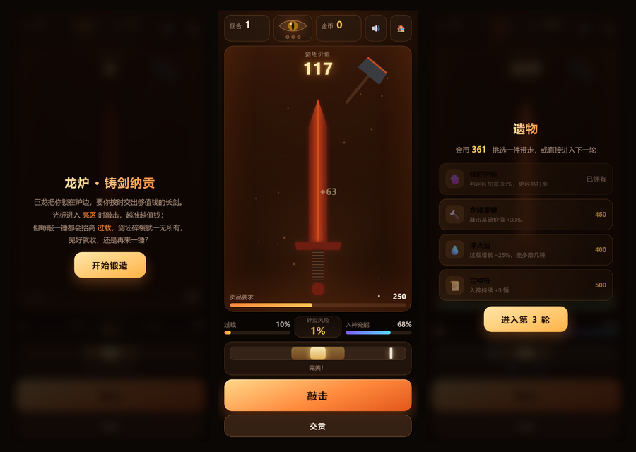

# 🔥 龙炉 · 铸剑纳贡

一个**手机优先**的锻剑押注小游戏，玩法灵感来自 Steam 的 [ForgeTax](https://store.steampowered.com/app/5245810/ForgeTax/)：**敲得越多价值越高，碎裂的风险也越大。**

纯原生 HTML / CSS / JavaScript，**零依赖、零构建**，把仓库挂在 GitHub Pages 上就能当服务器玩。



**在线试玩：<https://qiuye-autumnnight.github.io/dragon-forge/>**

> 手机上打开链接即可开玩；在浏览器菜单里选「添加到主屏幕」会全屏启动，断网也能玩。
> 想玩别的？回到 [🎮 游戏盒](https://qiuye-autumnnight.github.io/)。

## 核心循环

巨龙把你锁在炉边，要你按时交出够值钱的长剑。每一轮：

1. **计时敲击** —— 光标在轨道上来回移动，进入亮区时敲下去。越准越值钱。
2. **押注决策** —— 每敲一锤都抬高**过载**，过载越高，下一锤**碎裂风险**越大。碎裂就一无所有。
3. **见好就收还是再来一锤？** —— 随时可以交贡；达标则拿钱，不达标则**龙怒 +1**。
4. **攒钱买遗物** —— 用金币买永久增益，靠连锁效应撑过后面越来越离谱的贡品要求。
5. **龙怒满 3 次，游戏结束。**

## 命中判定

| 判定 | 价值 | 过载 | 充能 |
| --- | --- | --- | --- |
| **完美**（亮白窄区） | ×3.0 | +5 | +34 |
| **不错**（橙色亮区） | ×1.5 | +9 | +17 |
| **偏了**（其余区域） | ×0.6 | +16 | −20 |

而且**敲得越多，光标跑得越快**（每锤 +0.055，最高 2.15/秒）——想一直打完美是不可能的，这本身就是「再敲一锤」的代价。

## 入神

连续精准命中会累积充能，满 100 进入**入神**状态：价值 ×2.5、过载增量减半、光标变慢。持续 6 锤（买了「定神符」是 9 锤）。这是唯一能安全冲高价值的窗口。

## 碎裂风险

界面上显示的百分比，就是你**此刻下手会碎剑的准确概率**——不是模糊暗示，是可以拿来做决策的数字。

```
风险 = min(上限, (过载/100) ^ 2.2)
```

- 过载 40% → 风险 13%
- 过载 60% → 风险 33%
- 过载 80% → 风险 61%
- 默认上限 95%（买了「秘银砧」降到 60%，永不必然碎裂）

过载超过 62% 时剑身会**浮现裂纹**，作为危险预告。

## 遗物

| 遗物 | 价格 | 效果 |
| --- | --- | --- |
| 🧤 铁匠护腕 | 300 | 判定区加宽 35% |
| 💧 淬火油 | 400 | 过载增长 −25% |
| 🔨 龙鳞重锤 | 450 | 敲击基础价值 +30% |
| 📜 定神符 | 500 | 入神持续 +3 锤 |
| 🕯️ 巨龙香料 | 550 | 贡品要求 −12% |
| 👁️ 贪婪之眼 | 650 | 价值 +60%，过载 +30% |
| ⚒️ 秘银砧 | 700 | 碎裂风险上限降至 60% |
| 🔥 复燃符 | 800 | 每轮首次碎裂保留 40% 价值 |

## 数值

- 单锤基础价值 `18 × (1 + 已敲锤数 × 0.16)`，所以第 15 锤大约是第 1 锤的 3.2 倍
- 贡品要求 `250 × 1.62^(回合-1)`：250 → 410 → 660 → 1070 → 1730 → …
- 交贡成功拿全额金币；失败只返还 40%，且龙怒 +1

## 操作

| 操作 | 说明 |
| --- | --- |
| 点「敲击」按钮 或 点计时条 | 挥锤 |
| 点「交贡」按钮 | 上交当前剑坯 |
| 空格 / `Enter` | 敲击（弹窗时等于点按钮） |
| `S` | 交贡 |

## 特性

- 🔨 **Canvas 锻炉场景**：剑身按热度变色（暗红 → 橙 → 金黄 → 白热）、火星飞溅、铁锤挥落、屏幕震动
- 🐉 **龙眼会变红**：龙怒越高，眼睛越红、跳得越快
- ⏱️ **可决策的风险数字**：显示的是精确概率，不是模糊的「有点危险」
- 📴 **离线可用**：Service Worker 缓存全部资源
- 🏆 **历史最远回合**保存在本机
- 🔊 Web Audio 合成音效（锤击/碎裂/龙吼/金币）+ 手机震动反馈

## 本地运行

用到了 Service Worker，请用 HTTP 方式打开，不要直接双击 `index.html`：

```bash
python -m http.server 8000
```

然后访问 <http://localhost:8000>。

## 文件结构

```
.
├── index.html              # 页面结构
├── styles.css              # 样式与响应式布局
├── game.js                 # 游戏逻辑与 Canvas 渲染
├── sw.js                   # Service Worker（离线缓存）
├── manifest.webmanifest    # PWA 清单
├── icons/                  # 各尺寸图标
├── screenshot.png          # README 预览图
└── .nojekyll               # 跳过 Jekyll
```

## 实现要点

- **先加过载、再按新过载判定碎裂**：这样界面上那个百分比就是「你现在下手会碎的概率」，玩家能真正拿它做决策，而不是靠猜
- **锤子挥动角度的两个极端都留在画布内**：抬起 −2.45 rad、砸下 +0.72 rad，锤头正好落在剑身中上部（第一版会把锤子甩出右边缘，看着像根悬空的棍子）
- **`flex: 1 1 0` 而不是 `auto`**：画布高 100%，用 auto 基准会和父容器形成循环依赖导致高度塌陷
- **渐变每帧重建可接受，但光标位置不每帧读 DOM**：计时条宽度在 resize 时缓存
- 这是**致敬玩法的原创实现**，没有使用 ForgeTax 的任何素材、代码或名称

## License

[MIT](./LICENSE)
